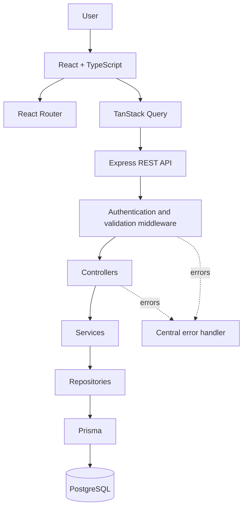
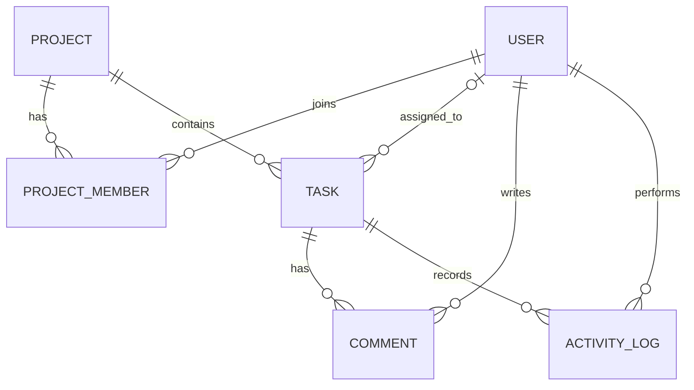

DevFlow
DevFlow is a full-stack project management application built to explore maintainable application architecture, secure API development, and modern React workflows.

It brings projects, team membership, tasks, and progress insights together in one workspace-like experience—without introducing a separate Workspace domain model.
Project status: Actively developed. This README describes the known project structure and planned developer workflows. Public deployment, CI results, and release readiness should be verified before being advertised as available.

Features
The current codebase contains modules for:
- Authentication: registration, sign-in, session-related flows, and protected routes.
- Project management: create, view, edit, and delete projects.
- Project membership: add and remove members, and manage project roles.
- Task management: create, update, filter, and delete tasks; organize tasks on a Kanban board.
- Dashboard: project statistics, task completion and progress charts, overdue tasks, and workload views.
- Collaboration foundations: comments, activity history, mentions, and notifications in the API codebase.
These items reflect shared source-file structure, not an independently verified end-to-end feature audit. Actual behavior and access rules should be validated against the application and tests.

Tech stack
Area	Technologies
Frontend	React, TypeScript, Vite
UI	Tailwind CSS, shadcn/ui
Routing	React Router
Server state	TanStack Query
Client state	Zustand
Forms and validation	React Hook Form, Zod
Backend	Node.js, Express, TypeScript
Database	PostgreSQL
ORM	Prisma
Authentication	Cookie/session and token-based authentication components
API documentation	OpenAPI / Swagger (documentation status to be verified)
Tests	Vitest, React Testing Library, Supertest, Playwright
Tooling and delivery	pnpm workspaces, Docker, GitHub Actions (configuration and execution status to be verified)

Architecture
DevFlow uses a feature-oriented frontend and a layered backend. The backend separates HTTP handling, business rules, and data access.

Design principles
- Keep controllers focused on HTTP requests and responses.
- Put business rules and resource-level authorization in services.
- Isolate persistence concerns in repositories where the abstraction adds value.
- Use TanStack Query for remote/server data, Zustand for genuinely shared client state, and React Hook Form for form state.
- Prefer a testable modular monolith over premature microservices or unnecessary abstractions.
Project structure
devflow/
├── apps/
│   ├── web/
│   │   └── src/
│   │       ├── app/             # Providers and routing
│   │       ├── components/      # Shared UI
│   │       ├── features/        # Auth, projects, tasks, dashboard
│   │       ├── layout/          # Page layouts
│   │       ├── pages/           # Route-level pages
│   │       ├── lib/             # HTTP and query configuration
│   │       ├── services/        # Shared API infrastructure
│   │       ├── stores/          # Zustand state
│   │       └── styles/          # Global styles and tokens
│   └── api/
│       └── src/
│           ├── config/         # Environment and integrations
│           ├── routes/         # HTTP endpoints
│           ├── middlewares/    # Authentication, validation, errors
│           ├── controllers/    # HTTP request/response handlers
│           ├── services/       # Application business rules
│           ├── repositories/   # Database access
│           ├── schemas/        # Request validation
│           └── lib/            # Logging and infrastructure
├── .github/workflows/         # CI configuration
└── README.md
The tree is intentionally abbreviated. The API also contains generated Prisma client code and additional shared utilities.
Data model
The core domain includes User, Project, ProjectMember, Task, Comment, and ActivityLog. Additional Prisma models in the shared structure include Mention, Notification, and RefreshToken.

This is a conceptual overview, not a substitute for the actual Prisma schema. Relationship optionality and delete behavior must be checked against the schema before changing database constraints.
Getting started
Prerequisites
- A Node.js version supported by the repository's package.json and CI configuration
- pnpm, using the version declared in the root packageManager field
- PostgreSQL
- Redis if enabled by the current backend configuration
1. Clone and install
git clone <YOUR_REPOSITORY_URL>
cd devflow
corepack enable
pnpm install --frozen-lockfile
Replace <YOUR_REPOSITORY_URL> with the real GitHub URL.
2. Configure the environment
Review apps/api/src/config/env.ts and the available environment example files. Create the appropriate local environment files in apps/api/ and apps/web/, using the exact variable names required by the source code.

The API requires a PostgreSQL connection and authentication-related configuration. Redis, CORS, cookie, CSRF, and frontend API URL settings depend on the current setup. Do not commit .env, .env.test, real tokens, or credentials.
3. Prepare the database
After configuring the database URL and confirming the Prisma CLI configuration, generate the Prisma client and apply migrations:
pnpm --filter @devflow/api exec prisma generate
pnpm --filter @devflow/api exec prisma migrate deploy
migrate deploy applies committed migrations. Use the project-specific development workflow if you need to create a new migration. Confirm that the @devflow/api workspace name and CLI commands match the actual package.json scripts.
4. Start the applications
Run the API and web app in separate terminals using their defined scripts. For example, if both workspaces expose a dev script:
pnpm --filter @devflow/api dev
pnpm --filter @devflow/web dev
Check the console output for the local URLs and ensure the web app's API base URL points to the backend.
Testing and quality
The project uses unit, component, integration, and browser E2E testing tools. The following commands reflect previously shared development notes; verify them against the committed scripts before use:
# Frontend
pnpm --filter @devflow/web test:typecheck
pnpm --filter @devflow/web test:coverage
pnpm --filter @devflow/web build

# Backend
pnpm --filter @devflow/api typecheck
pnpm --filter @devflow/api build
pnpm --filter @devflow/api exec vitest run --coverage

# Browser E2E (requires an isolated test environment)
pnpm --filter @devflow/web exec playwright test
Important: Integration and E2E tests may create or delete data. Run them only against a deliberately isolated test database and the environment safeguards defined by the repository. GitHub Actions configuration does not, by itself, establish that remote CI checks have passed.
Security approach
The API structure includes authentication and authorization middleware, request validation, CSRF configuration, rate limiting, logging, and token-related services. Security is an ongoing engineering practice: these files should not be taken as proof that every threat model or deployment configuration has been audited.

Never expose production credentials in commits, screenshots, logs, CI artifacts, or issue reports.
API documentation
The API follows a REST-oriented structure. A verified Swagger UI URL or OpenAPI specification link will be added here once its location and generated output are confirmed.
Demo and screenshots
A public demo URL and screenshots will be added after the deployment and visual assets have been verified. No live demo is claimed in this version of the README.
Roadmap
- [ ] Validate all setup commands against a clean clone
- [ ] Finalize and verify OpenAPI / Swagger documentation
- [ ] Verify CI checks in GitHub Actions
- [ ] Add architecture and schema documentation based on actual code
- [ ] Publish and verify a demo environment
- [ ] Add application screenshots
- [ ] Prepare changelog and GitHub v1.0.0 release
Why DevFlow?
DevFlow is a learning and portfolio project focused on production-oriented full-stack engineering: clear boundaries, type safety, secure defaults, automated testing, and understandable technical trade-offs. Its architecture is intentionally practical and designed to evolve as requirements become clearer.
License
A license has not been specified in the shared project information. Add a LICENSE file and update this section if you intend to grant reuse rights.
