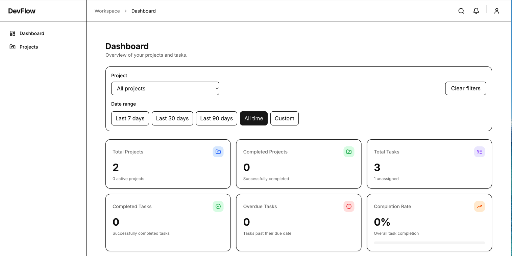
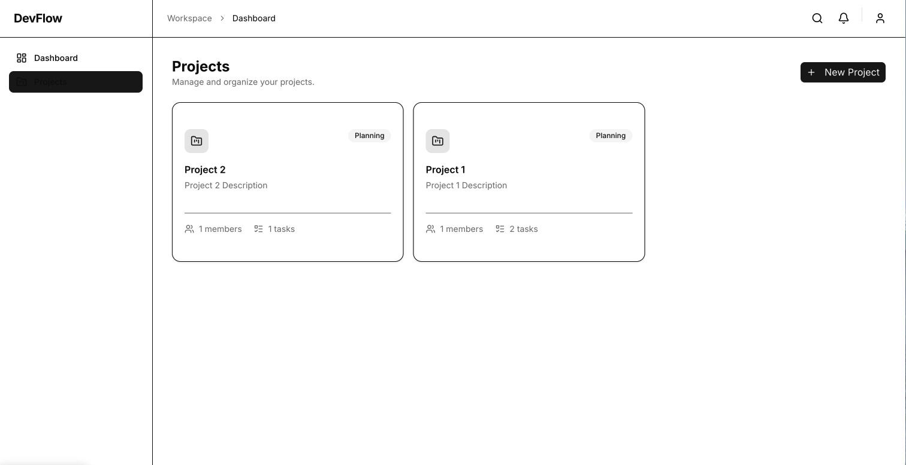
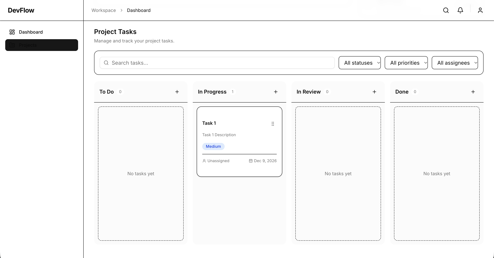
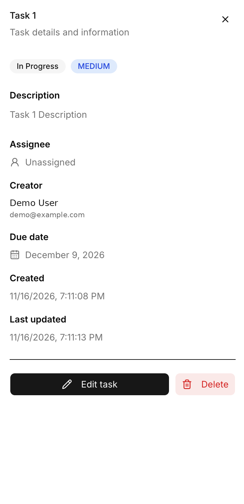
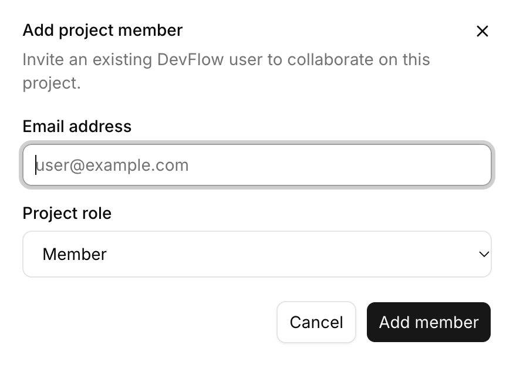
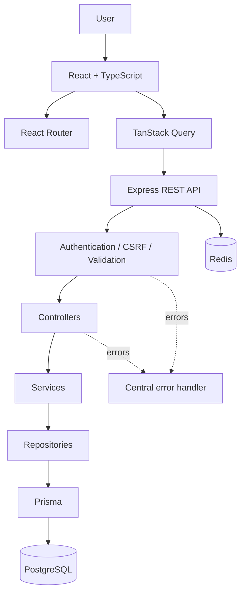

# DevFlow

**DevFlow** is a full-stack project management application built as a portfolio and learning project, with an emphasis on maintainable architecture, secure API development, and modern React workflows.

It brings project management, team membership, task tracking, Kanban workflows, and progress insights into one application. DevFlow does **not** use a separate Workspace domain model.

> **Project status:** Local-first portfolio application. The Docker-based local-production stack and core user workflows have been successfully smoke-tested by the project author. No publicly hosted demo is planned at this stage; GitHub `v1.0.0` release preparation is ongoing.

## Features

- **Authentication:** Registration, sign-in and sign-out, JWT-based access tokens, refresh-token flows, protected routes, and CSRF protection.
- **Projects:** Create, browse, edit, and delete projects.
- **Project membership:** Invite existing users by email, manage `OWNER` / `ADMIN` / `MEMBER` permissions, and leave or remove members according to role rules.
- **Tasks and Kanban:** Create, update, filter, assign, and move tasks across workflow stages.
- **Dashboard:** Project summaries, workload insights, overdue tasks, and activity information.
- **Collaboration:** Comments, task activity history, mentions, and notifications.
- **API documentation:** OpenAPI specification and Swagger UI in the development environment.

## Screenshots

### Dashboard



### Projects



### Kanban Board



### Task Details



### Project Members



> Screenshots show the locally running application. The Project Members image depicts the **add-member dialog**, not a full membership administration view.

## Tech Stack

| Area | Technologies |
| --- | --- |
| Frontend | React, TypeScript, Vite |
| UI | Tailwind CSS, shadcn/ui, Lucide icons |
| Routing | React Router |
| Server state | TanStack Query |
| Client state | Zustand, where shared client state is needed |
| Forms and validation | React Hook Form, Zod |
| Backend | Node.js, Express, TypeScript |
| Database and ORM | PostgreSQL, Prisma |
| Cache and infrastructure | Redis, Docker, Nginx |
| Authentication and security | JWT, refresh-token cookies, CSRF protection, rate limiting, Helmet |
| API documentation | OpenAPI 3.1, Swagger UI |
| Testing | Vitest, React Testing Library, Supertest, Playwright |
| Automation | pnpm workspaces, GitHub Actions, GHCR image publishing |

## Architecture

DevFlow is a modular monolith with a feature-oriented frontend and a layered backend. HTTP handlers, business rules, and persistence responsibilities are separated.



**Design principles:**

- Keep controllers focused on request and response handling.
- Put business rules and resource-level authorization in services.
- Use repositories for database access without adding unnecessary abstractions.
- Use TanStack Query for server state, Zustand for genuinely shared client state, and React Hook Form for form state.
- Prefer a testable modular monolith to premature microservices.

See [Architecture](docs/architecture.md) and [Technical Decisions](docs/technical-decisions.md) for more detail.

## Data Model

Core models include `User`, `Project`, `ProjectMember`, `Task`, `Comment`, and `ActivityLog`, alongside `Mention`, `Notification`, and `RefreshToken`. Project ownership is associated with the project owner, while project membership defines collaboration roles.

See the [Database Documentation](docs/database.md) for the ER diagram and data-model details. The Prisma schema is the source of truth for constraints and relations.

## Repository Structure

```text
devflow/
├── apps/
│   ├── web/                 # React frontend
│   └── api/                 # Express API, Prisma, OpenAPI
├── docker/                  # Local-production Compose and environment configuration
├── docs/
│   ├── screenshots/
│   ├── architecture.md
│   ├── database.md
│   ├── getting-started.md
│   ├── technical-decisions.md
│   └── deployment.md
├── .github/workflows/       # Automated checks and Docker image workflow
├── pnpm-workspace.yaml
└── README.md
```

## Getting Started

### Prerequisites

- Node.js **24**
- pnpm **12.18.0** (declared in the root `package.json`)
- PostgreSQL **17** and Redis **7** (or equivalent reachable instances compatible with the project configuration)
- Docker and Docker Compose for the container-based workflow

### Install dependencies

From the repository root:

```bash
corepack enable
pnpm install --frozen-lockfile
```

Configure the API and web environments using `apps/api/.env.example`, `apps/web/.env.example`, and [Getting Started](docs/getting-started.md). The backend requires both PostgreSQL and Redis, as well as JWT and CSRF secrets. Never commit `.env` files or credentials.

### Development workflow

Start the required PostgreSQL/Redis services and apply the database migrations following the [Getting Started guide](docs/getting-started.md). The application development commands are:

```bash
pnpm dev:api
pnpm dev:web
```

For complete environment variables, migration commands, and troubleshooting, see **[Getting Started](docs/getting-started.md)**.

## Local Production with Docker

DevFlow has been run and smoke-tested using the **local-production** Docker Compose stack, with healthy API, web, PostgreSQL, and Redis services. The author also verified project creation, task creation, Kanban status changes, data persistence, and logout/login flows.

The stack serves the web application locally at **http://127.0.0.1:8080/** (also accessible as `http://localhost:8080/` on the same computer). PostgreSQL, Redis, and the API remain inside the production Compose network; only the web reverse proxy is exposed on the loopback interface.

The local-production configuration intentionally supports local HTTP and must **not** be exposed directly to the public internet. Refer to [Deployment](docs/deployment.md) for the actual Docker build, migration, and Compose procedures.

**No hosted demo or public domain is currently provided.**

## Testing and Quality

The repository includes unit, component, integration, and browser E2E testing infrastructure. Common commands:

```bash
# Backend
pnpm --filter @devflow/api typecheck
pnpm --filter @devflow/api test
pnpm --filter @devflow/api build

# Frontend
pnpm --filter @devflow/web typecheck
pnpm --filter @devflow/web test:run
pnpm --filter @devflow/web build
```

Playwright E2E tests use their own environment and configuration. **Do not run integration/E2E tests against an important database** without confirming isolation. Local typechecking, API tests, and the Docker smoke test were reported successful; remote GitHub Actions results have not been independently verified here.

## API Documentation

The REST API is documented using **OpenAPI 3.1**. The maintained specification is located at:

[`apps/api/docs/openapi/openapi.yaml`](apps/api/docs/openapi/openapi.yaml)

Swagger UI is available at **http://localhost:3000/api-docs/** when enabled in the local API development environment. It may be disabled in production configurations, including the local-production Docker stack. The API uses the `/api/v1` prefix.

## Security

DevFlow implements authentication, resource-level authorization, Zod validation, CSRF protection, request rate limiting, security headers, and logging. Access tokens, refresh cookies, and role checks are handled by the backend. These measures are not a claim of a formal security audit.

Use isolated test databases, keep secrets outside version control, and avoid disclosing personal information in screenshots or logs.

## Documentation

- [Getting Started](docs/getting-started.md)
- [Architecture](docs/architecture.md)
- [Database / ER Diagram](docs/database.md)
- [Technical Decisions](docs/technical-decisions.md)
- [Local Deployment](docs/deployment.md)
- [OpenAPI Specification](apps/api/docs/openapi/openapi.yaml)

## Release Status

The next milestone is the **GitHub `v1.0.0` release**. Before tagging, review CI results, repository hygiene, screenshots, documentation links, and release notes. A release is **not** claimed to exist until the tag and GitHub release are published.

## Why DevFlow?

DevFlow is a practical learning project for full-stack engineering, with an emphasis on type safety, clear module boundaries, secure defaults, maintainable tests, and architectural trade-offs that are understandable and explainable.

## License

No license is declared in the provided README. Add a `LICENSE` file and update this section if you intend to grant reuse rights. Without a license, the repository should not be presented as open source under a specific license.
