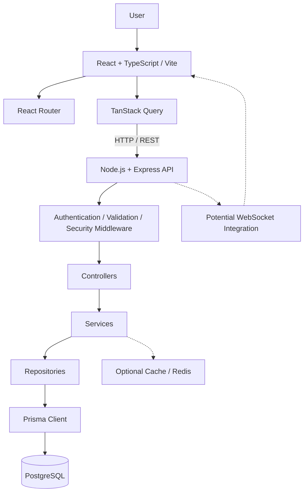
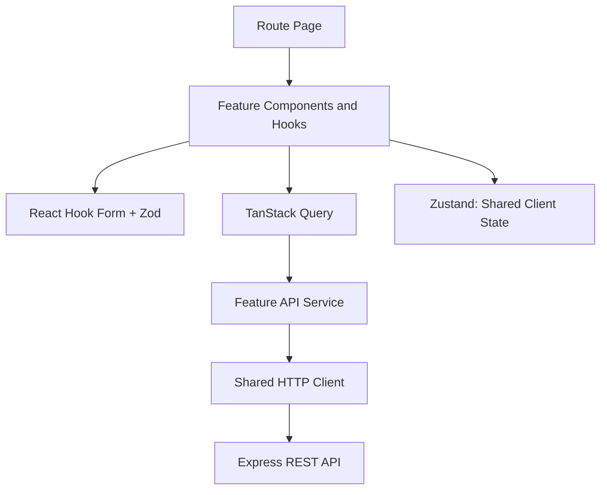
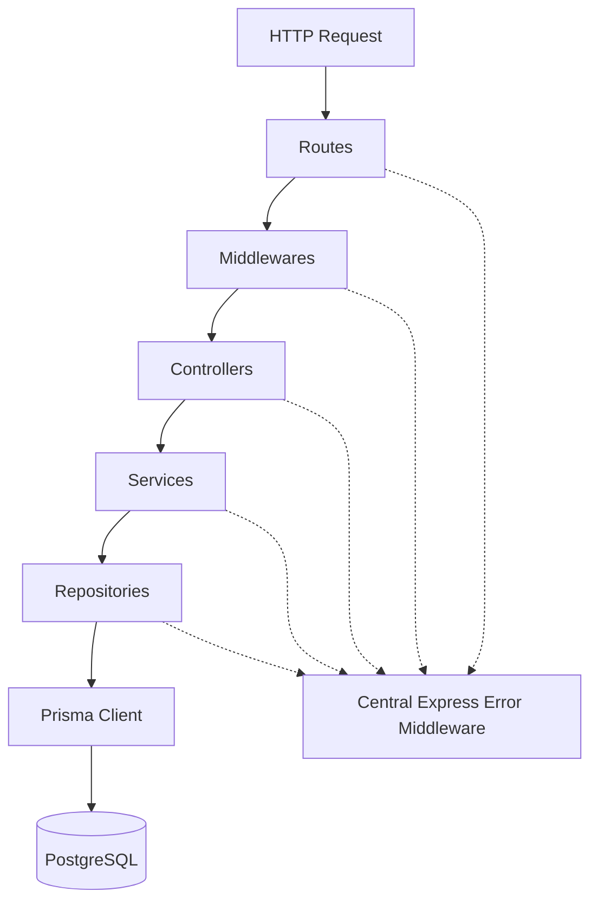
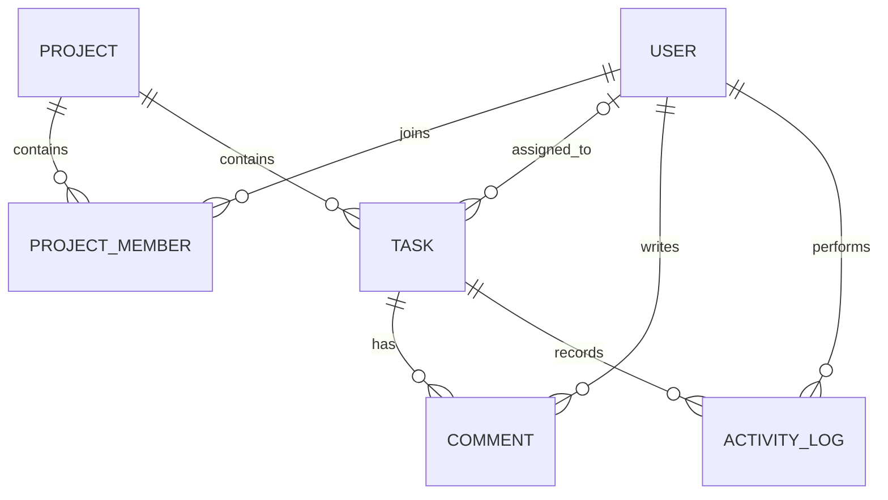

# DevFlow — System Architecture

> Architecture reference for the DevFlow project management application.
>
> This document describes the intended architecture based on the project's documented structure. It is not a code audit or deployment verification report.

## Overview

DevFlow is a full-stack project management application built as a React frontend and a Node.js/Express REST API backed by PostgreSQL. The codebase is organized as a monorepo with `apps/web` and `apps/api`.

The primary design goals are:

- **Separation of concerns:** UI, HTTP handling, business rules, and persistence have distinct responsibilities.
- **Feature ownership:** Related frontend code lives together in feature modules.
- **Type safety:** TypeScript is used across frontend and backend.
- **Testability:** Business logic and external integrations should be testable independently.
- **Pragmatic complexity:** Add infrastructure only when justified by a real requirement.

## System Context

**Note:** Redis-related modules exist in the provided backend file list (`config/redis.ts`, `lib/cache.ts`). This diagram treats caching as an optional integration; its current runtime use and deployment status require code verification. WebSocket is a future option, not a confirmed active integration.

## Frontend Architecture

**Stack:** React, TypeScript, Vite, React Router, TanStack Query, Zustand, React Hook Form, Zod, Tailwind CSS, and shadcn/ui.

### Folder Responsibilities

| Location | Responsibility |
| --- | --- |
| `src/app/` | Application configuration, providers, and routing |
| `src/components/` | Shared and reusable UI components |
| `src/features/` | Business features (`auth`, `projects`, `tasks`, `dashboard`) |
| `src/hooks/` | Cross-feature React hooks |
| `src/layout/` | Page layouts |
| `src/lib/` | Shared library configuration, including Axios and TanStack Query |
| `src/pages/` | Route-level pages |
| `src/schemas/` | Shared Zod validation schemas |
| `src/services/` | Shared HTTP/API infrastructure |
| `src/stores/` | Zustand stores for shared client state |
| `src/styles/` | Global styles and design tokens |
| `src/types/` | Shared TypeScript types |
| `src/utils/` | General-purpose utilities |

### State Ownership

- **Server state:** TanStack Query handles request lifecycle, caching, invalidation, and synchronization.
- **Form state:** React Hook Form, with Zod for validation.
- **Local UI state:** Component state where no cross-component sharing is necessary.
- **Shared client state:** Zustand only where state genuinely needs to be shared.

Avoid maintaining duplicate authoritative copies of API data in Zustand and TanStack Query.

## Backend Architecture

**Stack:** Node.js, Express, TypeScript, Prisma, and PostgreSQL.

The dotted error paths indicate **propagation** to Express error-handling middleware, not direct calls from services or repositories.

| Layer | Responsibility |
| --- | --- |
| Routes | Define endpoints and compose route-specific middleware |
| Middlewares | Handle authentication, validation, authorization checks, request security, and errors |
| Controllers | Translate HTTP requests into service calls and HTTP responses |
| Services | Apply business rules and resource-level access decisions |
| Repositories | Encapsulate database access through Prisma where useful |
| Config | Validate environment configuration and initialize dependencies |
| Central error handler | Convert application and unexpected errors into consistent HTTP responses |

### Backend Modules Seen in the File Inventory

The provided folder inventory includes code organized around authentication, projects, project memberships, tasks, comments, activities, dashboard, notifications, and mentions. It also contains token, security, logging, and cache-related modules. The presence of a file does not on its own verify that a feature is fully implemented or operational.

## Data Model

The original core domain comprises `User`, `Project`, `ProjectMember`, `Task`, `Comment`, and `ActivityLog`. The generated Prisma model inventory also includes `Mention`, `Notification`, and `RefreshToken`.

**Important:** This is a **conceptual core-domain diagram**, not an exact extraction of the current Prisma schema. Field names, optionality, referential actions, and relationships involving `Mention`, `Notification`, and `RefreshToken` must be verified against `schema.prisma` before publishing a definitive ER diagram.

### Existing Domain Decisions

- A task has at most one assignee.
- Activity history is scoped to tasks.
- The planned deletion strategy is hard delete; referential actions should be confirmed in the schema.
- Workspace management is outside the current scope.

## Request Lifecycle

1. A user navigates to a route in the React application.
2. The relevant feature requests data through TanStack Query and its API service.
3. The shared HTTP client sends the request to the Express REST API.
4. Express routing and middleware apply request-level concerns.
5. A controller delegates to a service.
6. The service enforces business rules and calls repositories as needed.
7. Repositories use Prisma to access PostgreSQL.
8. The API returns a response, or a centralized error handler produces an error response.
9. TanStack Query updates the relevant frontend query state.

## Security Boundaries

The backend inventory contains authentication, authorization, validation, CSRF, rate-limiting, and request-logging modules. The following are **verification targets**, not claims that every protection is active and correct:

- Credentials and tokens are protected in transport and storage.
- Project membership and role checks are enforced on protected resources.
- Mutating endpoints apply appropriate validation and CSRF protections where relevant.
- API error responses do not leak sensitive internals.
- Rate limits and security headers are configured appropriately for the deployment.

## Testing and Delivery

The selected testing tools are Vitest, React Testing Library, Supertest, and Playwright. Docker and GitHub Actions are included in the chosen DevOps stack. Exact scripts, CI status checks, deployment infrastructure, and coverage guarantees should be sourced from the current repository configuration before claiming them as operational.

## Architectural Decision Notes

1. **Use a layered backend:** Clear HTTP/business/data boundaries while avoiding redundant abstraction.
2. **Organize the frontend by features:** Keep feature-specific components, hooks, schemas, types, and services together.
3. **Separate server and client state:** TanStack Query for server data, Zustand only where shared client state is justified.
4. **Use PostgreSQL and Prisma:** Relational data modeling with type-safe database access.
5. **Defer infrastructure until justified:** Redis caching and WebSocket support should follow concrete use cases and operational requirements.

## Verification Checklist Before v1.0.0

- [ ] Compare these diagrams with the live imports and route configuration.
- [ ] Verify the actual Prisma schema and replace the conceptual ER diagram with an exact one.
- [ ] Confirm which cache/security integrations are active at runtime.
- [ ] Verify environment variables and all local development commands.
- [ ] Verify tests, workflows, and deployment status from the actual repository.
- [ ] Link this document from the root `README.md`.
