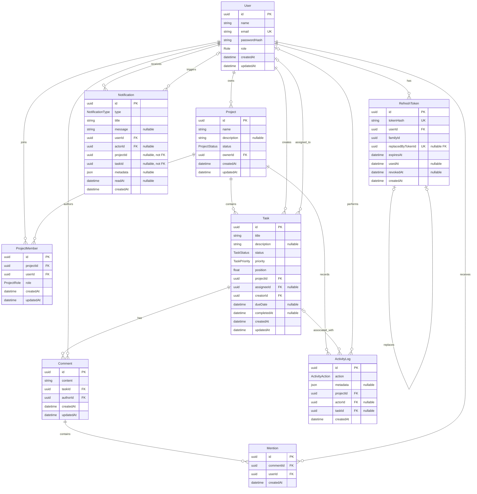

# DevFlow — Database Design

> **Source of truth:** `apps/api/prisma/schema.prisma` (schema supplied for this documentation). This document describes the schema as provided; it does not verify deployed migrations, live data, or application-level permissions.

DevFlow uses **PostgreSQL** with **Prisma ORM**. Identifiers are UUIDs. The schema consists of nine models: `User`, `RefreshToken`, `Project`, `ProjectMember`, `Task`, `Comment`, `ActivityLog`, `Notification`, and `Mention`.

## Entity relationship diagram

The diagram below shows **declared Prisma relations**. `Notification.projectId` and `Notification.taskId` are scalar UUID fields, not declared foreign-key relations, and therefore are not shown as relational edges.

**Cardinality note:** Optional relations are indicated by nullable foreign keys, including task assignee, activity actor/task, notification actor, and the refresh-token successor. The exact uniqueness and referential actions are defined by the Prisma schema rather than inferred from the diagram alone.

## Models and responsibilities

| Model | Purpose | Key relationships |
| --- | --- | --- |
| `User` | Accounts, credentials, and global role | Projects owned, memberships, tasks, comments, activity, notifications, mentions, refresh tokens |
| `RefreshToken` | Hashed refresh tokens and rotation families | Belongs to a user; optionally points to its replacement token |
| `Project` | Project metadata, owner, and lifecycle | Owner, members, tasks, activity logs |
| `ProjectMember` | Project-scoped membership and role | One user in one project |
| `Task` | Trackable project work and Kanban position | Project, creator, optional assignee, comments, activity |
| `Comment` | Task discussions | Task, author, mentions |
| `ActivityLog` | Project-linked audit/activity events, optionally task-specific | Project, optional task and actor |
| `Notification` | Notifications received by users | Recipient and optional actor; project/task IDs stored as scalar references |
| `Mention` | User mentions in comments | Comment and mentioned user |

## Enumerations

| Enum | Values |
| --- | --- |
| `Role` | `USER`, `ADMIN`, `MANAGER` |
| `ProjectRole` | `OWNER`, `ADMIN`, `MEMBER` |
| `ProjectStatus` | `PLANNING`, `ACTIVE`, `COMPLETED`, `ARCHIVED` |
| `TaskStatus` | `TODO`, `IN_PROGRESS`, `IN_REVIEW`, `DONE` |
| `TaskPriority` | `LOW`, `MEDIUM`, `HIGH`, `URGENT` |
| `NotificationType` | `TASK_ASSIGNED`, `TASK_MENTIONED`, `COMMENT_MENTIONED`, `COMMENT_CREATED` |
| `ActivityAction` | `TASK_CREATED`, `TASK_UPDATED`, `TASK_STATUS_CHANGED`, `TASK_PRIORITY_CHANGED`, `TASK_ASSIGNED`, `TASK_DELETED`, `COMMENT_CREATED`, `COMMENT_UPDATED`, `COMMENT_DELETED` |

## Integrity constraints

- `User.email` is unique.
- `RefreshToken.tokenHash` is unique; `RefreshToken.replacedByTokenId` is unique when non-null. Refresh tokens are indexed by user, family, expiry, and `(userId, familyId)`.
- A user can have **at most one membership per project**, enforced by `@@unique([projectId, userId])` on `ProjectMember`.
- A user can be mentioned **at most once per comment**, enforced by `@@unique([commentId, userId])` on `Mention`.
- `Task.assigneeId` is nullable, so tasks can be unassigned; each task has **at most one** assignee.
- `Task.position` is a floating-point column with a default of `0`. There is no schema-level uniqueness constraint on task positions.
- `Notification.projectId` and `Notification.taskId` are **not declared Prisma relations or foreign keys**. Their referential validity must be handled by application logic or a future schema change.
- Neither `Project.ownerId` nor `ProjectMember.role` enforces that the owner also has an `OWNER` membership; enforce that invariant in application logic if it is required.
- The database does not enforce that a task assignee or creator is a member of the task's project, or that `ActivityLog.taskId` belongs to `ActivityLog.projectId`. Those are application-level invariants unless additional constraints are introduced.

## Indexes relevant to access patterns

| Model | Declared indexes | Likely query support |
| --- | --- | --- |
| `Project` | `(ownerId)`, `(status)` | Owner's projects, status filters |
| `ProjectMember` | `(userId)`, `(projectId)` plus unique `(projectId, userId)` | Membership lookup and authorization |
| `Task` | `(projectId, status, position)`, `(assigneeId)`, `(creatorId)`, `(dueDate)`, `(projectId, createdAt)`, `(projectId, completedAt)` | Kanban lists, assignments, due dates, project activity and completion analytics |
| `Comment` | `(taskId, createdAt, id)`, `(authorId)` | Task discussion timeline |
| `ActivityLog` | `(projectId, createdAt, id)`, `(projectId, taskId, createdAt, id)`, `(actorId)`, `(taskId)` | Project/task activity feeds |
| `Notification` | `(userId, createdAt, id)`, `(userId, readAt, createdAt, id)`, `(projectId)` | Recipient inbox, unread filtering, project references |
| `RefreshToken` | `(userId)`, `(familyId)`, `(expiresAt)`, `(userId, familyId)` | Token lifecycle and rotation families |

These are *declared* indexes, not evidence that production query plans have been profiled.

## Referential deletion behavior

| Relationship | `onDelete` | Consequence |
| --- | --- | --- |
| `RefreshToken.user` | `Cascade` | Deleting a user deletes their refresh tokens |
| `RefreshToken.replacedBy` | `SetNull` | Deleting a successor clears its predecessor's replacement pointer |
| `Project.owner` | `Restrict` | A user who still owns projects cannot be deleted through this relation |
| `ProjectMember.project` / `.user` | `Cascade` | Deleting a project/user removes relevant memberships |
| `Task.project` | `Cascade` | Deleting a project deletes its tasks |
| `Task.assignee` | `SetNull` | Deleting an assignee clears their assignment |
| `Task.creator` | `Restrict` | Deleting a user who created surviving tasks is restricted |
| `Comment.task` | `Cascade` | Deleting a task deletes its comments |
| `Comment.author` | `Restrict` | Deleting a user who authored surviving comments is restricted |
| `ActivityLog.project` | `Cascade` | Deleting a project deletes its activity logs |
| `ActivityLog.actor` / `.task` | `SetNull` | Deleting an actor/task retains logs with those references cleared, unless the containing project itself is deleted |
| `Notification.user` | `Cascade` | Deleting the recipient deletes notifications |
| `Notification.actor` | `SetNull` | Deleting the actor keeps notifications but clears actor identity |
| `Mention.comment` / `.user` | `Cascade` | Deleting a comment or mentioned user removes mentions |

### Important deletion caveats

1. **Hard delete is not synonymous with deleting every related record.** `Restrict` and `SetNull` actions intentionally prevent or modify cascading deletion.
2. Deleting a task removes its comments and their mentions, but can leave project activity logs in place with `taskId = null`.
3. Project deletion cascades into tasks, memberships, and activity; however, notification `projectId` / `taskId` values are plain scalars and may become stale unless cleaned by application logic.
4. Because task creators and comment authors are `Restrict`, user account deletion requires a deliberate data-retention and ownership strategy.

## Authentication and authorization considerations

- Passwords are represented by `passwordHash`, not plaintext passwords.
- Refresh tokens are represented by `tokenHash`, grouped with `familyId`, and track usage, expiry, and revocation timestamps. **The schema supports** rotation/reuse-detection implementations but does not prove that those checks are enforced in code.
- Global `User.role` and per-project `ProjectMember.role` are distinct permission scopes. Project-level authorization should validate project membership, ownership, and the requested operation in application code.
- Database constraints protect referential integrity, but they do not replace endpoint/service-level authorization.

## Design considerations and follow-up checks

These are review items, **not confirmed defects**:

1. **Activity scope:** Earlier architecture notes described task-level activity; the current schema permits project-only records because `ActivityLog.taskId` is optional. Document or enforce the intended scope.
2. **Notification references:** Decide whether `projectId` and `taskId` should remain denormalized scalar identifiers or become actual relations. If left as scalars, specify cleanup behavior after deletion.
3. **Project ownership consistency:** If an owner must appear in `ProjectMember` with `OWNER`, enforce this in the service layer and preferably test it.
4. **Cross-project correctness:** Verify that task assignments, comments, activity entries, and notifications cannot cross project authorization boundaries.
5. **Deletion flows:** Test that Prisma referential actions match the intended hard-delete policy and that restricted user deletion is handled gracefully.
6. **Positioning:** Check the use of floating-point `Task.position` for frequent Kanban reordering, including tie resolution or occasional rebalancing.
7. **Live migrations:** Compare this document against committed Prisma migrations and the actual deployed schema before a v1.0.0 release.

## Prisma configuration

The provided schema configures a generated Prisma client at `../src/generated/prisma` and uses PostgreSQL as the datasource provider. The database connection URL is **not specified in the schema**; consult the project's actual Prisma configuration and environment setup guide for the source of connection settings.

## Documentation maintenance

Update this document and its diagram whenever a Prisma model, relation, enum, index, or referential action changes. Verify changes with migration review and automated integration tests before release.
